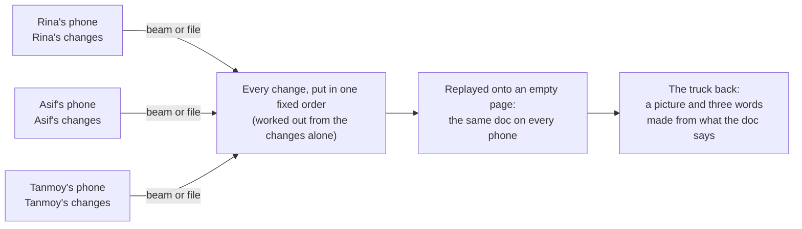

# Phir Milenge

**A document editor that works with no signal: phones swap what's new whenever they meet, by a moving code on the screen or a small file, in any order, and always end on the same doc.**

**Open the app:** https://ranvir7123.github.io/phir-milenge/


Open it once with internet, in Chrome on Android or Safari on iPhone (any recent browser works on a laptop). After that it works offline. "Phir milenge" means "we'll meet again"; it's painted on the backs of Indian trucks.

## Try it in 60 seconds, at a desk, with no phones

You need **two different browsers** (say Chrome and Edge) **or two browser profiles**. Two tabs or two windows of the same browser share one saved copy, so they act as one writer and there's nothing to sync.

1. **Browser 1:** open the link, type a name (say "Rina"), tap **Start a new doc**, pick **Camp log**, and pick a colour. Under "Roads and boats", write: `Gosaba ferry runs at 6 am. Bring ration cards to the jetty.`
2. In the **⋯** menu, tap **Save a file**. A small `.phir` file lands in your Downloads.
3. **Browser 2:** open the link, type another name (say "Asif"), and tap **or open a file** under the buttons. Pick that file. You now have Rina's doc. Pick a colour.
4. Now write apart, as if you had no signal:
   - In both browsers, change the first sentence of the ferry line, differently. Browser 1: `Gosaba ferry runs at 7 am.` Browser 2: `No ferry to Gosaba today.`
   - In Browser 2 only, change its second sentence: `Wait for the relief boat at 2 pm.`
5. Swap: **Save a file** in each browser, then **Open a file** in the other one.

**What you'll see in both browsers:** the second sentence simply changed (only one person touched it). The first sentence shows **both versions side by side**, each with its writer's name and time, because two people rewrote it apart. Nothing was lost. Both browsers show the same truck back (the picture and three words), which is how you can tell they hold the same doc. Tap **Keep this one** on either version, swap files again, and both settle the same way.

## How it stays the same on every phone



- **Every edit is a change with a name.** The name is the phone's id plus a counter, and the change lists what its writer had already seen. A catch only ever *adds* the changes you don't have yet; it never removes anything.
- **One fixed order.** Every phone sorts the changes the same way: a change always comes after what its writer had seen, and ties are broken by the writer's time, then the phone's id, then the counter. Then it replays them onto an empty page. The order depends only on the changes, never on when or how they arrived, so the same changes give the same doc everywhere.
- **Sentence clashes, nobody loses.** A paragraph is stored sentence by sentence. Two people changing *different* sentences just combine. Two people rewriting the *same* sentence apart get both versions kept, side by side, until someone taps **Keep this one** (which is a change too, so it travels). Deleting a paragraph someone else was editing shows as "Deleted by Tanmoy" next to their words. A table cell is always kept whole.
- **Settle rules.** One tap can settle every clash at once: **Keep the newest one**, **Keep one person's**, or **For numbers, keep the smaller one**. The rule is applied when the doc is shown, not by rewriting it, so every phone settles the same way and the losing versions stay behind "1 other".
- **Check rules.** Rules written inside the doc, like "One kit per ration card" or "Tarpaulins stay within 500", are checked on the doc as shown, after every change, with every version of an open clash counted. Same changes in, same broken rules out, on every phone, whatever order they synced in. A broken rule is a warning, never a block.
- **The truck back.** A SHA-256 fingerprint of everything a printout would show (text, tables, open clashes, kept versions, rules), turned into a picture, three words from a list of 256, and two digits. Times, history and "who has this" notes are left out, so the same doc gives the same truck back however it got there.

The longer version, with a worked example: [docs/how-it-works.md](docs/how-it-works.md).

## The 1,000-order test

```bash
npm ci
npm run selftest
```

Four simulated phones (Base camp, Rina, Asif and Tanmoy) start from one Camp log and write apart: two rewrites of the same sentence, changes to different sentences of one paragraph, a delete against an edit, two rows breaking "one kit per ration card", two changes to one table cell, a pick and its undo, and "Keep the newest one". Each step prints "passed" or "FAILED" and what it found.

Then every phone catches every other, each phone's truck back words are printed, and all the changes are shuffled into 1,000 different arrival orders and fed through the same path a real catch uses. The last line reads **"1000 of 1000 the same: \<three words\>"**: all 1,000 orders produced the exact same doc, down to its truck back. If any order came out different, the last line starts with FAILED and says how many were the same. The shuffles come from a fixed starting number, so a failing run repeats exactly. It's 1,000 tries, not a proof.

The same test runs inside the app: on the laptop, **⋯ → Run the 1,000-order test**.

## Honest about what exists

Every piece exists somewhere: animated codes in Bitcoin wallets, carry-it-forward sync in Briar, replay in Etherpad, kept conflicts in Pijul, fingerprints in Signal, rule-keeping in database research. We couldn't find anyone who has put them together into a phone document editor that works with no signal at all.

## Known limits

- **A phone that lies on purpose isn't defended against.** Every phone in a doc is trusted, and today a phone could write under someone else's name. Two things still hold: a catch only adds, so it can't silently remove your words, and every change stays in the history, so damage can be seen in the replay and undone. The fix we'd build next: each phone makes a signing key on first open, and other phones refuse changes not signed by that writer.
- **Beam speed and doc size.** A beam sends the whole doc, not just what's new. We estimate about 2 KB a second on our phones (the beam test page, `?beam-test`, measures the real number on any two devices), so a 120 KB doc takes about a minute and the app warns before it starts. A file has no size limit.
- **A browser can wipe its storage.** Clearing site data, or a phone short on space, can delete the docs this website saved. iPhone Safari may also clear a website's data after about a week without a visit, unless the app is added to the home screen. Every phone you've beamed to still has your words, and **Save a file** keeps another copy anywhere.
- **A phone that never opened the link with internet can't join.** The app is a web page that saves itself for offline use the first time it loads. A phone that has never loaded it has nothing to run. Open the link once with internet before you go offline.
- **Two tabs of one browser are one writer.** They share one saved copy, so syncing them does nothing. Use two browsers or two browser profiles to try it at a desk.

## Run it yourself

```bash
npm ci
npm run dev          # the app, at the address it prints
npm run typecheck
npm test
npm run build
npm run selftest     # the 1,000-order test
npm run demo:docs    # the stage demo's starting docs, as .phir files in demo-files/
```

The stage demo's week of writing is prepared by `src/demo/scenario.ts`, with the times set to last week; every sync on stage is live. `?demo-setup` loads a device as one of the demo's writers.

## Team

<!-- Four names, one per line, and nothing else. -->

- ________________
- ________________
- ________________
- ________________
