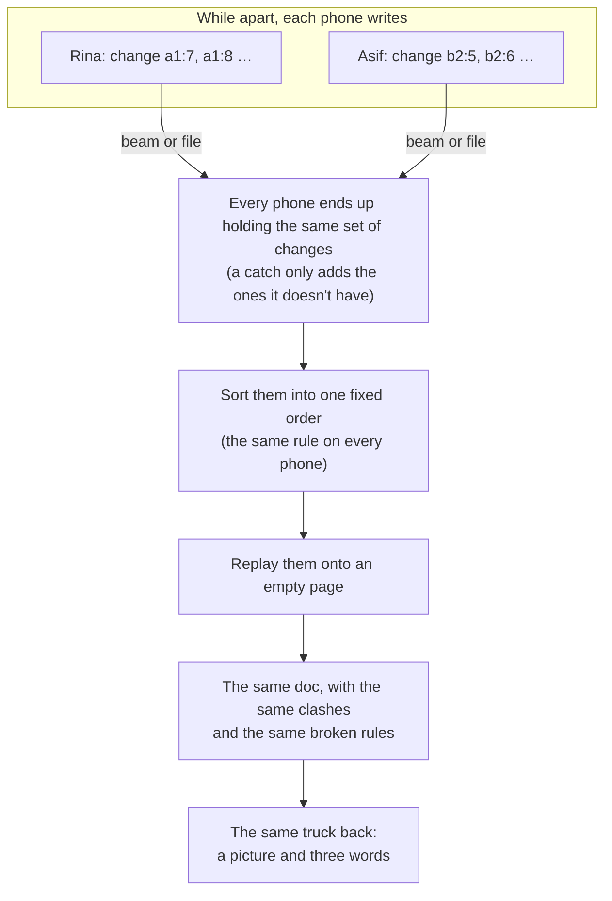

# How every phone ends on the same doc

Relay Docs has no server. Every phone keeps the whole doc, and phones swap what's new when they meet: one shows a moving code and the other's camera catches it, or one saves a small `.relay` file and the other opens it. They can meet in any order, as often as they like, and they always end on the same doc. This page explains why, in plain words.

## The short version

The doc is never sent as "the doc". What travels is the list of **changes**, and every phone works the doc out from them in exactly the same way.

## 1. Every edit is a change with a name

When you type, the app groups your typing (one change per short pause) into a **change**. A change holds:

- **its name:** your phone's id and a counter that goes up by one, like `a1a1…:17`. No two changes ever share a name, so a phone that catches the same change twice simply skips it.
- **what you had already seen:** the newest changes on your phone when you made it. This is how every other phone knows what you were looking at when you wrote.
- **your clock's time and where you were** ("Gosaba camp"), for showing in the doc. The time is never used to decide what the doc says, with one exception explained in section 5.
- **what changed:** only two kinds of step. *Set* writes a value into a named spot (a sentence, a table cell, a tick, the title, a rule, your colour). *Insert* adds a new item into a list after another (a new paragraph, a new sentence, a table row).

A **catch** (a beam or a file) carries every change the other phone has. Your phone keeps the ones it didn't have, and nothing is ever removed.

## 2. One fixed order

To show the doc, a phone takes every change it holds and sorts them:

1. A change always comes after everything its writer had already seen.
2. When two changes could go next, the one with the earlier writer's time goes first, then the smaller phone id, then the smaller counter.

Then it replays the changes in that order onto an empty page. The order depends only on the changes themselves, never on when or how they arrived. So two phones holding the same changes always show the same doc, whether they caught Rina first or Tanmoy's file first.

## 3. Two versions, nobody loses

Each named spot (a sentence, say) remembers **every value that nobody has seen past yet**. When a change writes a spot, it replaces only the values its writer had already seen. A value the writer never saw stays.

**A worked example**, from the stage demo. Before the camps split up, the doc said:

> Gosaba ferry times are not known yet. Ask at the jetty.

- On Monday at 6:05 am, at Gosaba camp, Rina rewrites it: *Gosaba ferry runs at 6 am. Bring ration cards to the jetty.*
- On Monday at 4:10 pm, at Patharpratima camp, Asif rewrites it: *No ferry to Gosaba today. The jetty is under water; wait for the relief boat at 2 pm.*

Neither had seen the other's change. When both reach Base camp, each sentence of that paragraph holds two values, so the doc shows **both versions side by side**, each with its writer, place and time. A normal sync tool would keep only one of them, usually whichever arrived last, and could send families to a flooded jetty.

Other cases work the same way:

- **Different sentences of one paragraph:** Rina changes the first sentence of the road line ("…open for trucks until 4 pm.") and Asif changes the second ("…Diesel is at the Canning pump, 40 litres left."). Each sentence has only one new value, so both changes simply appear. No clash.
- **A delete against an edit:** Tanmoy deletes the doctor's-boat paragraph while Rina adds "by 9 am" to it. Rina's sentence shows as two versions, "Deleted by Tanmoy" and Rina's words. The sentences only Tanmoy touched are simply gone.
- **A table cell:** Rina writes "Family kit" and Tanmoy writes "Tarpaulin" in the same cell. A cell is always kept whole, so it shows two versions.
- **Style (heading or paragraph), bold, italic, links:** these never clash. The later writer's time wins.

**Keep this one** is a change too. It's written after seeing every version, so it replaces them all, and it remembers what it replaced so "1 other" can bring it back. Because it travels like any change, every phone settles the same way.

## 4. Sentences

A sentence ends at a full stop, question mark, exclamation mark or `।` followed by a space, or at a line break. Joining a paragraph's sentences always gives back its exact text. Only the writer's phone works out which sentences changed; every other phone just replays the result, so the phones never have to agree on how to split. A wrong split (like "Dr. Sen") only makes a clash a little bigger. It never loses words.

## 5. Settle rules

A doc can have one settle rule: **Always ask** (the default), **Keep the newest one**, **Keep one person's**, or **For numbers, keep the smaller one**. The rule is a value in the doc, and it's applied when the doc is shown, not by rewriting anything. So one tap settles every clash at once, every phone settles the same way, and the losing versions stay behind "1 other". Setting the rule back to Always ask brings every version back.

**Keep the newest one** is the one place clocks matter. It uses the times written inside the changes, never the reading phone's own clock, so every phone still picks the same winner. A phone whose clock is wrong can win "newest", and its time then shows "clock looks wrong".

## 6. Check rules

Rules written inside the doc, like "One kit per ration card" or "Tarpaulins stay within 500", are values in the doc too. After every change, the app checks them against the doc as shown. While a cell has two versions, both are counted, to be safe. Same changes in, same broken rules out, on every phone, whatever order the changes arrived in.

That's the mistake behind the Amphan relief audit: every camp's list was fine on its own, and the double payments only showed once the lists were put together. In the demo, Rina's camp and Tanmoy's camp each give a family kit to ration card 4471. Neither phone sees a problem. The moment both reach Base camp, "One kit per ration card" breaks, on every phone that has both.

A broken rule is a warning, never a block, because a kit already given out can't be taken back.

## 7. Who has this

When a phone catches anything new, it writes a small **note** change: "this phone now has everything up to here, caught from Meher, by beam". Notes travel like any change. So any phone can work out which other phones already have a paragraph (like blue ticks, with no network), and the trail of how it got here. Notes are left out of the truck back, so knowing who has what never changes what the doc says.

## 8. The truck back

The truck back is made from **what the doc says**, not its history: the title, every block in order with its style and text, open clashes (every version, in a fixed order), settled spots, tables, rules and the settle rule. That's written out in one fixed way and run through SHA-256, a standard fingerprint function. The first three bytes pick three words from a list of 256, the next gives two digits, and the picture is drawn from the same fingerprint. One changed letter changes the words.

Two phones with the same truck back hold the same doc. Two different docs share the three words about 1 time in 16.7 million, and the digits settle any doubt.

## 9. Checking it: 1,000 shuffled orders

`npm run selftest` (and the laptop's **Run the 1,000-order test**) takes a doc's changes, shuffles them into 1,000 different arrival orders, feeds each through the same path a real catch uses, and compares the truck backs. "1000 of 1000 the same" means every order gave the exact same doc. The shuffles are made from a fixed starting number, so any order that came out different can be saved and replayed.

It compares what the doc *says*, not the history (which would always match), so a mistake in sentences, clashes, settling or rules would show up as a different truck back. It's 1,000 tries, not a proof.

## 10. "What a normal sync would keep"

Each phone also records the order changes first arrived on it. The laptop's normal-sync switch uses that to show, for each clash, only the version that arrived last, which is what most sync tools would keep. It's a view only; it never changes the doc. On stage, Asif's week is loaded onto Base camp first, so Rina's 6 am line always arrives later, whatever order the judge picks.
